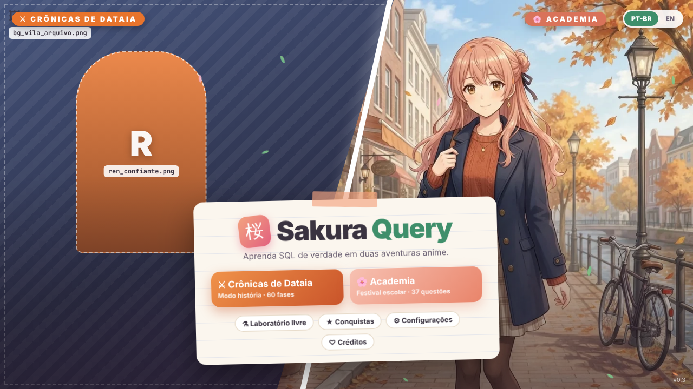
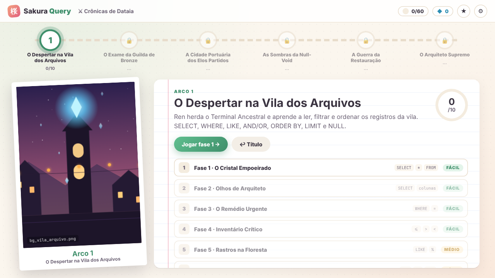
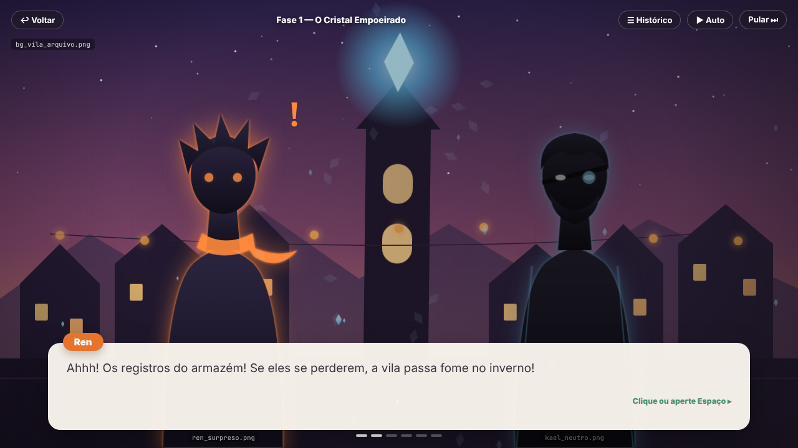
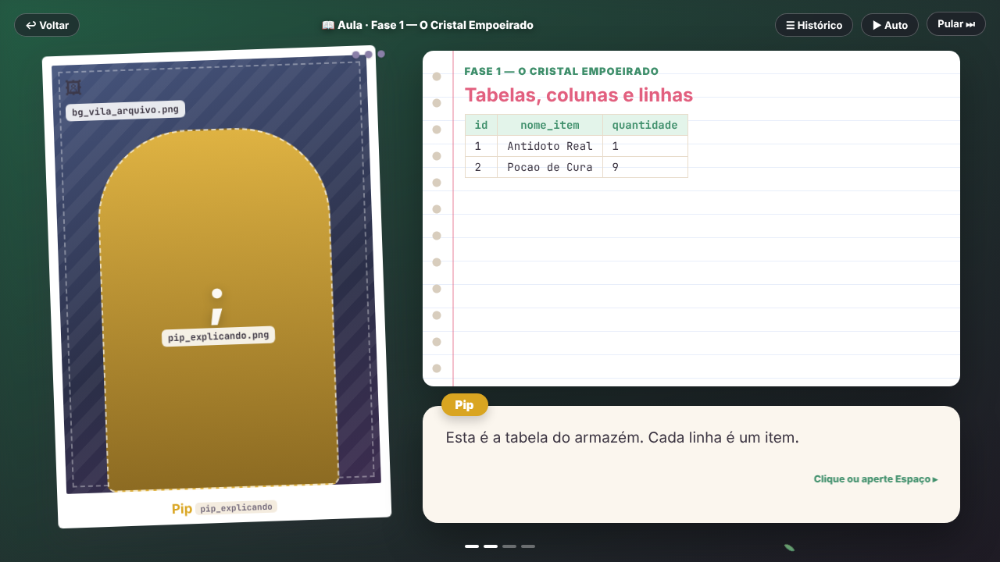
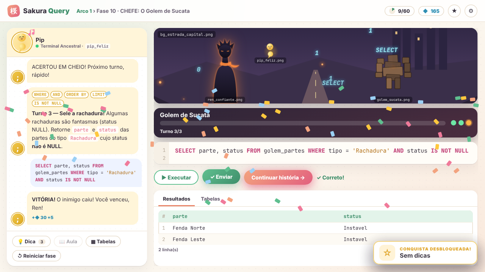
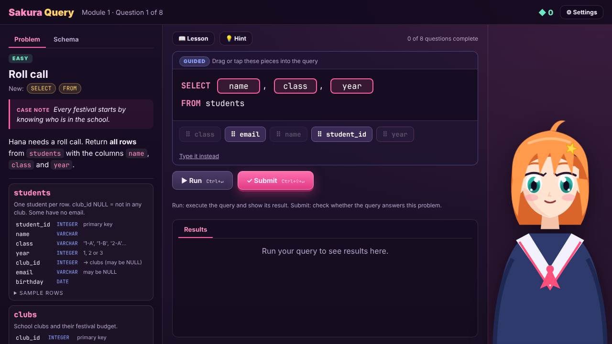
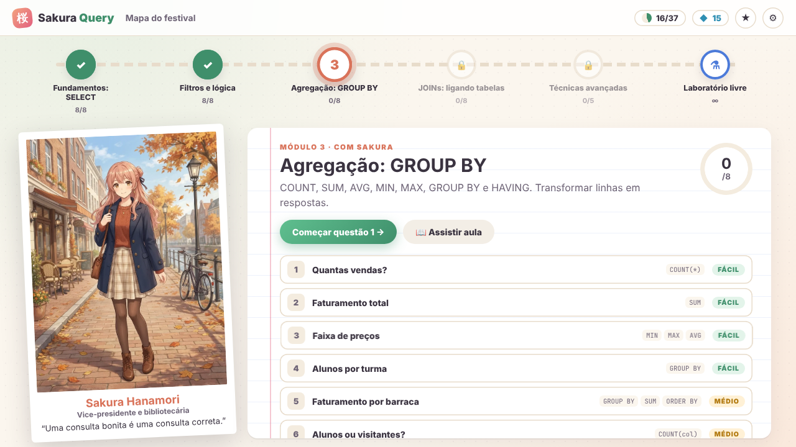

# Sakura Query 🌸

Jogo para PC, com tema de anime, que ensina **SQL de verdade**. Cada resposta roda num banco SQLite real.
Interface em **Português (BR)** e **Inglês**. O SQL não é traduzido; os nomes de tabelas e colunas sim
(`inventario_vila` em PT, `village_inventory` em EN).

Dois modos:

### ⚔ Crônicas de Dataia (modo história, shonen)
Ren herda o Terminal Ancestral do pai desaparecido e, com o Pip (um ponto e vírgula falante), enfrenta a Null-Void.
60 fases em 6 arcos, do `SELECT` até `CREATE TABLE`, `INDEX` e transações. **Pronto: Arco 1 (fases 1 a 10)**.

- Cada fase: cena de história → aula no caderno → desafio no Terminal (chat com o Pip) → cena final.
- **Cada capítulo (arco) é uma sessão contínua**: a fase termina e já emenda num cartão animado da próxima,
  a vitória avança sozinha depois de uma contagem regressiva, e o fim do arco mostra um resumo do capítulo.
- **O Pip explica cada comando novo**: antes do desafio ele entra voando com um cartão e uma mini-tabela
  animada mostrando o comando em ação; depois da primeira vez que o jogador usa o comando, ele comenta o
  resultado com os números da consulta. O **Grimório** guarda tudo para rever. Textos e animações em
  `data/comandos.json`.
- Chefes com **turnos e barra de vida** (ex.: Golem de Sucata, 3 turnos).
- Botão **Reiniciar fase**; o banco é recriado do zero a cada execução, então nada que o jogador faça estraga os dados.
- Qualquer SQL válido que produza o resultado certo é aceito (a ordem só conta quando a fase pede `ORDER BY`).
- Imagens provisórias: enquanto um sprite ou cenário não existe, aparece uma caixa com o nome do arquivo.
  Veja a lista completa em [docs/ASSETS.md](docs/ASSETS.md).

### 🌸 Academia (modo extra)
A Midori e a Sakura ensinam SQL organizando o Festival Escolar: **5 módulos, 37 questões**.

### Para os dois
- Modo **guiado** (arrastar peças) nas primeiras fases e **editor** com destaque de sintaxe.
- Executar (`Ctrl+Enter`) e Enviar (`Ctrl+Shift+Enter`), 3 dicas por desafio, ver resposta, gemas, conquistas.
- **Laboratório livre**, progresso salvo automaticamente, 100% offline.










## Rodar

Precisa do [Node.js](https://nodejs.org) 18 ou mais novo.

```bash
cd sql-anime-game
npm install
npm start
```

Para testar rápido sem instalar nada, também dá para abrir `src/index.html` direto no navegador.

## Gerar o executável

```bash
npm run dist:win
```

Também há `npm run dist:linux` e `npm run dist:mac`. O resultado fica em `dist/`.

## Testar o conteúdo

```bash
npm test
```

Monta os dados e roda todas as respostas oficiais (Academia e Dataia, em PT e EN) contra o banco.
Também confere se o gabarito em PT e em EN devolve o mesmo número de linhas e colunas.

## Crônicas de Dataia: como os dados funcionam

```
data/
  elenco.json          personagens (nome, cor, título) — a chave é o começo do nome do sprite (ren_, pip_...)
  arcos/arco_01.json   título do arco, capa e o banco do arco (tabelas, colunas e linhas em PT e EN)
  fases/fase_01.json   uma fase: cenas, aula, desafios, dicas e gabaritos em PT e EN
src/assets/sprites/    ren_confiante.png, pip_erro.png ...  (.png, .webp ou .jpg)
src/assets/bg/         bg_vila_arquivo.png ...
```

`tools/build-data.js` (roda sozinho no `npm start` e `npm test`) junta tudo em `src/js/data.bundle.js`
e atualiza `docs/ASSETS.md`. Depois de editar um JSON, rode `npm run build:data`.
Para imagens não é preciso rodar nada: é só colocar o arquivo com o nome certo.

Uma fase (`data/fases/fase_XX.json`):

```json
{
  "id": 3, "arco": 1, "cenario": "bg_vila_arquivo", "dificuldade": "facil",
  "titulo": { "pt": "O Remédio Urgente", "en": "The Urgent Cure" },
  "missao": { "pt": "...", "en": "..." },
  "conceitos": ["WHERE", "="],
  "historia_antes": [ { "sprite": "ren_surpreso", "pt": "fala", "en": "line" }, { "sprite": null, "pt": "narração", "en": "narration" } ],
  "aula": [ { "sprite": "pip_explicando", "pt": "...", "en": "...", "quadro": { "codigo": { "pt": "SELECT ...", "en": "SELECT ..." } } } ],
  "desafios": [ {
    "enunciado": { "pt": "...", "en": "..." },
    "gabarito": { "pt": "SELECT * FROM inventario_vila WHERE ...", "en": "SELECT * FROM village_inventory WHERE ..." },
    "ordenado": false,
    "dicas": [ { "pt": "...", "en": "..." }, { "pt": "...", "en": "..." }, { "pt": "...", "en": "..." } ],
    "guiado": { "pt": { "modelo": "SELECT []\nFROM []", "pecas": ["*", "inventario_vila"] }, "en": { "modelo": "...", "pecas": [] } }
  } ],
  "historia_depois": [ ],
  "chefe": { "nome": { "pt": "Golem de Sucata", "en": "Scrap Golem" }, "sprite": "golem_sucata", "hp": 3 }
}
```

`quadro` (anotação no caderno durante a aula) pode ser `titulo`, `codigo`, `nota` ou `tabela`.

Cada fala também aceita animação:

- `"efeito"`: um ou vários de `tremor`, `flash`, `relampago`, `escuridao`, `luz`, `cristais`, `dados`,
  `glitch`, `impacto`, `veneno`, `corte`, `desmoronar`. Ex.: `"efeito": ["escuridao", "relampago"]`.
- `"entra"`: coloca personagens no palco sem falar. Ex.: `"entra": ["kael_neutro"]`.
- `"sai"`: tira personagens do palco. Ex.: `"sai": ["vex"]`.

Sem imagens, os cenários do Arco 1 são desenhados e animados pelo código (`src/js/fx.js`), o Pip é
desenhado por completo e os outros personagens aparecem como silhuetas com olhos brilhando e expressão.
Quando a imagem real existir, ela entra por cima e as partículas e efeitos continuam.
Num chefe, cada item de `desafios` é um turno. `guiado` e `chefe` são opcionais.

## Estrutura

| Arquivo | O que tem |
|---|---|
| `main.js`, `preload.js` | Janela do Electron, tela cheia, sair, ponto de ligação com a Steam |
| `src/js/content.js` | **Todo o conteúdo**: módulos, aulas, falas, questões, dicas, respostas, conquistas |
| `src/js/db.js` | Banco do festival (`students`, `clubs`, `stalls`, `sales`) e descrição do esquema |
| `src/js/i18n.js` | Textos da interface em PT e EN |
| `src/js/characters.js` | Midori e Sakura: ilustrações, avatares e "emotes" de reação |
| `src/assets/chars/` | Ilustrações das personagens (`.webp`) |
| `src/js/game.js` | Tela título, modo Academia, verificação das respostas, progresso, conquistas |
| `src/js/dataia.js` | Modo história: mapa, cenas, Terminal do Pip, chefes por turnos, imagens provisórias |
| `data/`, `tools/build-data.js` | Dados do modo história e o script que monta o pacote |
| `src/js/audio.js` | Efeitos e música gerados pelo código |
| `src/vendor/sql-asm.js` | SQLite compilado para JavaScript ([sql.js](https://github.com/sql-js/sql.js), MIT) |

### Como uma resposta é corrigida

A consulta do jogador e a resposta oficial rodam num banco novo. O jogo compara o número de colunas,
o número de linhas e os valores (com arredondamento em 4 casas). Se a questão tiver `ordered: true`,
a ordem das linhas também conta. Os nomes das colunas não contam, então qualquer apelido serve.

### Adicionar uma questão

Coloque um objeto na lista `challenges` de um módulo em `src/js/content.js`:

```js
{
  id: 'm1q9', diff: 'easy', kw: ['WHERE'],
  title: T('Título PT', 'Title EN'),
  note: T('Nota do caso', 'Case note'),
  text: T('Enunciado com **negrito** e `código`', 'Problem text'),
  hints: [T('dica 1', 'hint 1'), T('dica 2', 'hint 2'), T('resposta', 'answer')],
  solution: 'SELECT ...',
  ordered: false,            // true se a ordem das linhas importar
  // guided: { template: 'SELECT []\nFROM students', pieces: ['name', 'year'] },
  react: T('Fala ao acertar', 'Line when correct'),
}
```

Depois rode `npm test`.

Publicação na Steam: veja [docs/STEAM.md](docs/STEAM.md).
