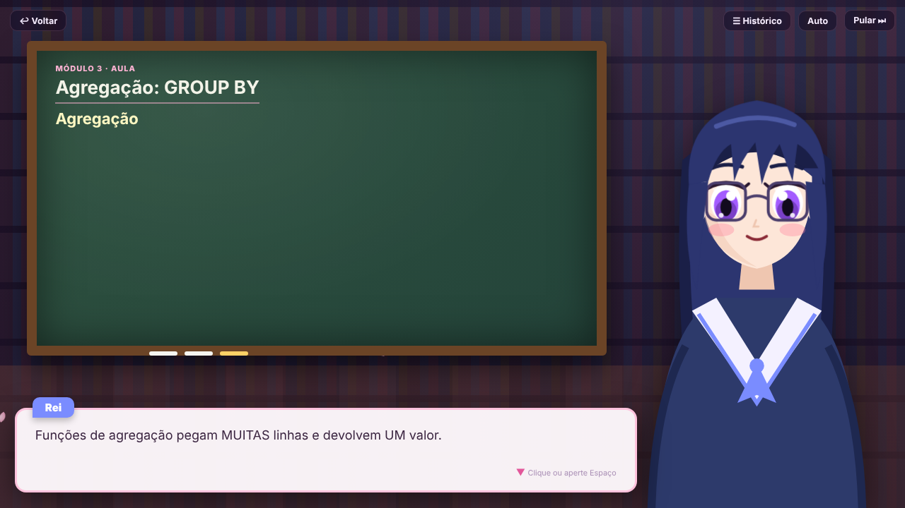

# Sakura Query 🌸

Jogo para PC, com tema de anime, que ensina **SQL de verdade**. Você entra no Clube de Dados da
Academia Hoshizora e, com a Hana e a Rei, organiza o banco de dados do Festival Escolar.
Cada questão roda uma consulta real num banco SQLite.

- Interface em **Português (BR)** e **Inglês** (troca na tela inicial ou em Configurações). O SQL não é traduzido.
- **5 módulos, 37 questões**, com aula na lousa, cenas de história e um chefe no fim de cada módulo:
  1. Fundamentos: `SELECT`, `FROM`, `WHERE`, `ORDER BY`, `LIMIT`, `DISTINCT`
  2. Filtros e lógica: `AND`/`OR`, `IN`, `BETWEEN`, `LIKE`, `IS NULL`, `AS`, `CASE`
  3. Agregação: `COUNT`, `SUM`, `AVG`, `MIN`/`MAX`, `GROUP BY`, `HAVING`, `ROUND`
  4. JOINs: `INNER JOIN`, `LEFT JOIN`, anti-join, JOIN com agregação, vários JOINs
  5. Avançado: subconsultas, CTE (`WITH`), funções de janela (`RANK`, `ROW_NUMBER ... PARTITION BY`)
- Modo **guiado** (arrastar ou tocar nas peças) nas primeiras questões e **editor** com destaque de sintaxe.
- Executar (`Ctrl+Enter`) e Enviar (`Ctrl+Shift+Enter`), 3 dicas por questão, ver resposta, gemas, 10 conquistas.
- **Laboratório livre** para escrever qualquer consulta no banco do festival.
- Progresso salvo automaticamente. Funciona 100% offline.




## Rodar

Precisa do [Node.js](https://nodejs.org) 18 ou mais novo.

```bash
cd sql-anime-game
npm install
npm start
```

Para testar rápido sem instalar nada, também dá para abrir `src/index.html` direto no navegador.

## Gerar o executável

```bash
npm run dist:win
```

Também há `npm run dist:linux` e `npm run dist:mac`. O resultado fica em `dist/`.

## Testar o conteúdo

```bash
npm test
```

Roda todas as respostas oficiais contra o banco e avisa se alguma quebrou.

## Estrutura

| Arquivo | O que tem |
|---|---|
| `main.js`, `preload.js` | Janela do Electron, tela cheia, sair, ponto de ligação com a Steam |
| `src/js/content.js` | **Todo o conteúdo**: módulos, aulas, falas, questões, dicas, respostas, conquistas |
| `src/js/db.js` | Banco do festival (`students`, `clubs`, `stalls`, `sales`) e descrição do esquema |
| `src/js/i18n.js` | Textos da interface em PT e EN |
| `src/js/characters.js` | Hana e Rei desenhadas em SVG, com 7 expressões |
| `src/js/game.js` | Telas, verificação das respostas, progresso, conquistas |
| `src/js/audio.js` | Efeitos e música gerados pelo código |
| `src/vendor/sql-asm.js` | SQLite compilado para JavaScript ([sql.js](https://github.com/sql-js/sql.js), MIT) |

### Como uma resposta é corrigida

A consulta do jogador e a resposta oficial rodam num banco novo. O jogo compara o número de colunas,
o número de linhas e os valores (com arredondamento em 4 casas). Se a questão tiver `ordered: true`,
a ordem das linhas também conta. Os nomes das colunas não contam, então qualquer apelido serve.

### Adicionar uma questão

Coloque um objeto na lista `challenges` de um módulo em `src/js/content.js`:

```js
{
  id: 'm1q9', diff: 'easy', kw: ['WHERE'],
  title: T('Título PT', 'Title EN'),
  note: T('Nota do caso', 'Case note'),
  text: T('Enunciado com **negrito** e `código`', 'Problem text'),
  hints: [T('dica 1', 'hint 1'), T('dica 2', 'hint 2'), T('resposta', 'answer')],
  solution: 'SELECT ...',
  ordered: false,            // true se a ordem das linhas importar
  // guided: { template: 'SELECT []\nFROM students', pieces: ['name', 'year'] },
  react: T('Fala ao acertar', 'Line when correct'),
}
```

Depois rode `npm test`.

Publicação na Steam: veja [docs/STEAM.md](docs/STEAM.md).
